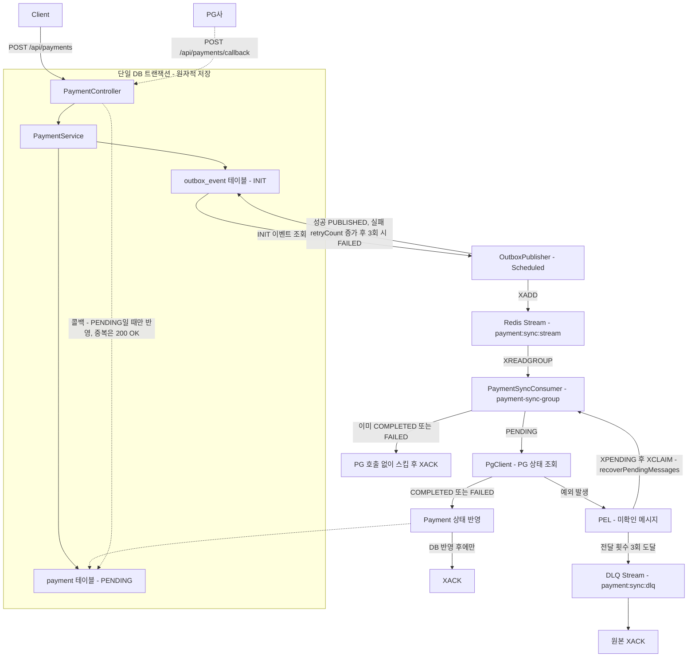

# Payment Sync Outbox

결제 상태 동기화를 **Transactional Outbox + Redis Streams** 기반 비동기 파이프라인으로 구현한 프로젝트입니다.
PG 콜백 유실, 일시적 PG 장애, 메시지 중복 전달 같은 상황에서도 결제 상태가 최종적으로 일관되게 수렴하도록 설계했고, 각 시나리오를 실제 MySQL/Redis 위에서 통합 테스트로 검증했습니다.

| 항목 | 내용 |
|---|---|
| 기술 스택 | Java 17 · Spring Boot 3.5 · Spring Data JPA · MySQL 8.0 · Redis 7 (Streams) · Docker Compose |
| 전달 모델 | at-least-once + 컨슈머 멱등성 |
| 운영 전제 | 단일 인스턴스 기준 (아래 [한계와 트레이드오프](#한계와-트레이드오프) 참고) |
| 테스트 | 전체 33개 통과, 이 중 종단간 장애 시나리오 4개 (`EndToEndPaymentSyncTest`) |

---

## 1. 배경: As-Is vs To-Be

### As-Is — 주기적 DB 폴링
결제 요청 후 PG 콜백을 기다리되, 콜백이 오지 않을 경우를 대비해 스케줄러가 `PENDING` 결제를 주기적으로 조회해 PG에 상태를 묻는 구조를 가정합니다.

| 한계 | 설명 |
|---|---|
| 불필요한 DB I/O | 대부분의 건이 이미 확정됐거나 아직 PG 처리 전인데도 매 주기마다 전체 `PENDING` 대상을 스캔 |
| 콜백 유실 시 복구 지연 | 복구 시점이 폴링 주기에 종속되고, 건수가 늘수록 한 주기에 처리할 양이 커짐 |
| 다중 인스턴스 중복 실행 | 인스턴스마다 스케줄러가 같은 건을 집어 PG를 중복 호출할 위험 |

### To-Be — Transactional Outbox + Redis Streams
- 결제 저장과 **동기화 요청 이벤트 저장을 같은 DB 트랜잭션**으로 묶습니다. (Dual-Write 제거)
- 이벤트는 Outbox 테이블에서 읽어 Redis Streams로 발행하고, **Consumer Group** 워커가 건별로 PG 상태를 조회해 반영합니다.
- 폴링 대상이 "전체 PENDING 결제"가 아니라 "발행되지 않은 Outbox 이벤트(`status, created_at` 인덱스)"로 좁혀지고, 이후 처리는 스트림 기반으로 건별 진행됩니다.
- 콜백이 먼저 오든, 늦게 오든, 유실되든 **상태 전이 검증**으로 같은 결과에 수렴합니다.
- 실패 건은 PEL 회수 재시도 후 한도를 넘으면 **DLQ로 격리**됩니다.

---

## 2. 시스템 아키텍처



**흐름 요약**
1. 결제 등록 시 `payment(PENDING)`와 `outbox_event(INIT)`가 한 트랜잭션으로 저장됩니다.
2. `OutboxPublisher`가 INIT 이벤트를 오래된 순으로 읽어 Redis Stream에 `XADD`하고 `PUBLISHED`로 바꿉니다.
3. `PaymentSyncConsumer`가 Consumer Group으로 메시지를 읽어 PG 상태를 조회하고, DB 반영이 끝난 뒤에만 `XACK`합니다.
4. 처리 실패 메시지는 PEL에 남고, 복구 로직이 일정 시간 이상 머문 건을 `XCLAIM`으로 회수해 재처리합니다.
5. 전달 횟수가 3회에 도달하면 원본 데이터와 실패 사유를 DLQ 스트림에 `XADD`하고 원본은 `XACK`합니다.

---

## 3. 핵심 설계 포인트와 트레이드오프

### 데이터 일관성 — Transactional Outbox
- **문제**: "DB에 결제 저장 → 브로커에 메시지 발행"을 각각 수행하면, 둘 중 하나만 성공했을 때 상태가 어긋납니다(Dual-Write).
- **해결**: 메시지를 브로커에 직접 보내지 않고 같은 트랜잭션 안에서 `outbox_event`로 저장합니다. 브로커 발행은 커밋된 이벤트를 읽어 별도로 수행합니다.
- **근거 테스트**: Outbox 저장에서 예외가 발생하면 이미 `saveAndFlush`된 Payment까지 롤백되어 DB에 아무것도 남지 않음을 검증했습니다 (`PaymentServiceTest`).
- **Poller 성능**: `(status, created_at)` 복합 인덱스로 INIT 이벤트를 오래된 순으로 조회합니다.

### 멱등성 제어 — at-least-once를 전제로 한 방어
- Poller는 `XADD` 성공 후 DB 반영이 실패하면 같은 이벤트를 다시 발행할 수 있고, PEL 재시도도 같은 메시지를 다시 전달합니다. 즉 **중복은 정상 상황으로 간주**하고 소비 측에서 막습니다.
- `Payment`는 `PENDING`에서만 `complete()`/`fail()`이 가능한 **상태 전이 검증**을 도메인 내부에 둡니다.
- 콜백(`POST /api/payments/callback`)과 컨슈머가 같은 규칙(`PENDING`일 때만 반영, 이미 확정이면 무시)을 공유합니다. 콜백이 먼저 오든 컨슈머가 먼저 처리하든 결과가 같고, 중복 콜백은 예외 없이 `200 OK`입니다.
- 컨슈머는 이미 확정된 건이면 **PG를 재호출하지 않고** 스킵 후 `XACK`합니다.
- 주문 단위 중복 등록은 `order_id` 유니크 제약이 최종 방어선입니다.
- 콜백은 저장된 `pgTransactionKey`와 일치할 때만 받습니다(불일치 400).

### 장애 복구와 격리 — PEL 회수 + DLQ
- 컨슈머는 **DB 반영이 끝난 뒤에만** `XACK`합니다. PG 오류 등으로 실패하면 ACK 없이 PEL에 남습니다.
- `recoverPendingMessages()`가 `XPENDING`으로 일정 시간(기본 3초) 이상 머문 메시지를 찾아 `XCLAIM`으로 회수해 재처리합니다.
- 전달 횟수가 한도(기본 3회)에 도달하면 더 재시도하지 않고 DLQ(`payment:sync:dlq`)로 격리합니다. DLQ에는 원본 필드, 원본 레코드 ID, 전달 횟수, 실패 사유가 함께 기록됩니다. 이 처리로 무한 재시도 루프를 방지합니다.
- PG 호출은 DB 트랜잭션 밖에서 수행해, 외부 호출 지연이 DB 커넥션/락을 붙잡지 않도록 했습니다.

### 한계와 트레이드오프

| 항목 | 현재 상태 | 비고 |
|---|---|---|
| Poller 다중 인스턴스 | **단일 인스턴스 전제.** 인스턴스를 늘리면 같은 INIT 이벤트를 중복 발행할 수 있음 | 중복은 컨슈머 멱등성으로 흡수되지만, 발행 자체의 중복 방지는 `SELECT ... FOR UPDATE SKIP LOCKED` 등으로 확장 필요 |
| 컨슈머 구성 | **컨슈머 그룹 1개(`payment-sync-group`) 안에 컨슈머 1개(`consumer-1`, 설정값으로 이름 고정).** 분산 처리는 하지 않음 | 그룹을 쓰는 이유는 분산이 아니라 PEL 기반 재시도(`XACK`/`XPENDING`/`XCLAIM`)와 DLQ 구조를 쓰기 위함 |
| DLQ 이후 | DLQ에 격리된 결제는 `PENDING`으로 남음 | 재처리/알림/수동 조치 도구는 미구현 |
| PG 연동 | `MockPgClient` (키에 `fail`/`error` 포함 여부로 시뮬레이션) | 실제 PG 구현체로 교체할 수 있도록 `PgClient`만 인터페이스로 분리 |
| 콜백 인증 | `pgTransactionKey` 일치 검사만 수행 | 실서비스에서는 서명 검증 등 필요 |

**단일 인스턴스인데 왜 Redis Streams인가**: 단일 인스턴스만 쓴다면 Outbox 테이블만으로도 재시도(`retryCount`, `FAILED`)를 구현할 수 있어서 Streams는 필수가 아닙니다. 그럼에도 선택한 이유는 (1) 발행(Poller)과 PG 조회(워커)를 분리해 PG 지연이 발행을 막지 않게 하고, (2) PEL 기반 재시도와 DLQ를 명시적인 구조로 두며, (3) 이후 컨슈머를 확장할 때의 출발점을 마련하기 위해서입니다. 위 (3)은 컨슈머 이름 고유화 등 추가 작업이 필요해 현재는 구현하지 않았습니다. 또한 Redis가 메시지를 잃으면(Outbox는 이미 `PUBLISHED`) 자동 복구 경로가 없으므로, 운영에서는 Redis AOF 활성화나 오래된 `PENDING` 결제를 다시 요청하는 보정 작업이 필요합니다.

설계 원칙: 단일 인스턴스를 기본으로 하되 동시 접근/중복 처리는 멱등성으로 방어하고, 불필요한 추상화(구현체가 하나뿐인 인터페이스)는 만들지 않았습니다.

---

## 4. 검증된 4대 장애 시나리오

`EndToEndPaymentSyncTest`는 실제 MySQL과 Redis Streams 위에서 `PaymentService` → `OutboxPublisher` → `PaymentSyncConsumer`(+ 콜백 API)를 모두 연결해 검증합니다. 각 단계를 직접 호출해 순서를 통제하며, 테스트가 만든 데이터는 종료 시 삭제하고 남은 것이 없는지까지 검증합니다.

| # | 시나리오 | 흐름 | 검증 결과 |
|---|---|---|---|
| 1 | **콜백 선도착 (멱등 처리)** | 결제 등록 → Outbox 발행 → PG 콜백(COMPLETED) 먼저 도착 → 컨슈머 소비 | PG 호출 없이 스킵, `COMPLETED` 유지, Pending 0건 |
| 2 | **콜백 유실 (자동 복구)** | 결제 등록 → 콜백 미수신(PENDING) → 발행 → 컨슈머 소비 | 컨슈머의 PG 조회로 `COMPLETED` 복구, Pending 0건 |
| 3 | **PG 일시 장애 (PEL 재시도)** | PG 1회 실패 후 성공 | 첫 소비 후 PEL에 1건 잔류 → `recoverPendingMessages()` 후 `COMPLETED`, PG 호출 2회, Pending 0건 |
| 4 | **PG 영구 장애 (DLQ 격리)** | PG 오류 3회 지속 | PG 호출 3회, 원본 Pending 0건, DLQ에 원본 데이터·전달 횟수·실패 사유 기록, 더 이상 재시도 없음 |

그 외 테스트: 도메인 상태 전이/유니크 제약(`PaymentTest`), Outbox 도메인 및 조회(`OutboxEventTest`), 등록 원자성/롤백(`PaymentServiceTest`), API 응답(`PaymentControllerTest`), Outbox 발행/실패 처리(`OutboxPublisherTest`), 컨슈머 기본 흐름(`PaymentSyncConsumerTest`), 멱등성·복구·DLQ(`PaymentSyncResilienceTest`).

---

## 5. 기술 스택과 실행 방법

### 기술 스택
Java 17 · Spring Boot 3.5 · Spring Data JPA · MySQL 8.0 · Redis 7 (Streams) · Docker Compose · Gradle

### 사전 준비
Java 17, Docker가 필요합니다.

```bash
# 1) 환경변수 파일 생성 (DB 계정/비밀번호; .env는 git에 올라가지 않음)
cp .env.example .env
#   .env 를 열어 DB_USERNAME / DB_PASSWORD / DB_ROOT_PASSWORD 를 채웁니다.
#   (MySQL 컨테이너는 최초 생성 시 이 값으로 초기화됩니다.)

# 2) MySQL 8.0, Redis 7 컨테이너 실행
docker compose up -d

# 3) 애플리케이션 실행
./gradlew bootRun

# 4) 테스트 (실제 MySQL/Redis 필요 → 2번이 먼저 실행되어 있어야 함)
./gradlew test
```

### 주요 API 예시

**결제 등록** — `201 Created` (같은 `orderId` 재요청은 `409 Conflict`)
```bash
curl -i -X POST http://localhost:8081/api/payments \
  -H 'Content-Type: application/json' \
  -d '{"orderId":"ORDER-001","pgTransactionKey":"pg-ok-001","amount":12000}'
```

**PG 콜백 수신** — `200 OK` (이미 확정된 건의 중복 콜백도 `200`)
```bash
curl -i -X POST http://localhost:8081/api/payments/callback \
  -H 'Content-Type: application/json' \
  -d '{"orderId":"ORDER-001","pgTransactionKey":"pg-ok-001","status":"COMPLETED"}'
```

콜백을 보내지 않아도 Poller가 이벤트를 발행하고 컨슈머가 Mock PG로 상태를 조회하므로 잠시 후 `COMPLETED`가 됩니다. `pgTransactionKey`에 `fail`을 포함하면 `FAILED`, `error`를 포함하면 PG 조회 예외(재시도 후 DLQ)를 시뮬레이션합니다.

### 주요 설정 (`application.yml`)
| 키 | 기본값 | 설명 |
|---|---|---|
| `app.outbox.stream-key` | `payment:sync:stream` | 발행 대상 Redis Stream |
| `app.outbox.max-retry-count` | `3` | Outbox 발행 실패 누적 시 `FAILED` 전환 기준 |
| `app.outbox.poller.enabled` | `true` | Outbox Poller 활성화 |
| `app.sync.consumer.enabled` | `true` | 컨슈머 워커 활성화 |
| `app.sync.recovery.enabled` / `min-idle-ms` / `max-delivery-count` | `true` / `3000` / `3` | PEL 회수 재시도 및 DLQ 이관 기준 |
| `app.sync.dlq-key` | `payment:sync:dlq` | DLQ 스트림 |

테스트에서는 스케줄러를 모두 끄고(`src/test/resources/application.properties`) 전용 스트림 키를 사용해, 백그라운드 동작이나 개발용 스트림과 간섭하지 않습니다.
